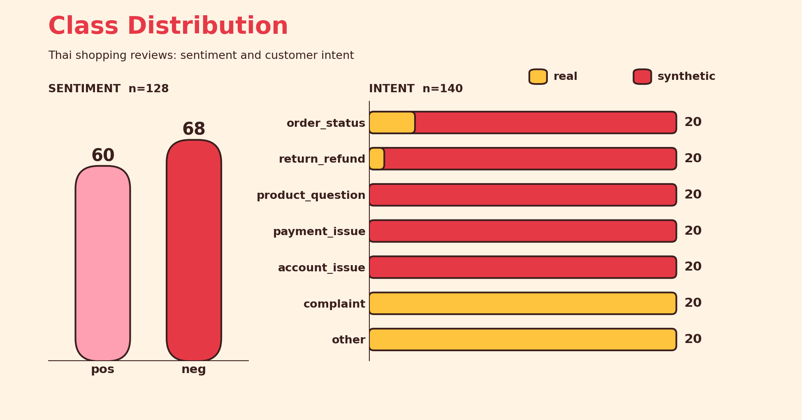

# Text Classification Tasks Evaluation

A collection of Thai-language datasets for evaluating text classification models on e-commerce customer text.

## Datasets

### 1. Shopping Review Sentiment

- **File:** `data/review_shopping_sentiment.csv`
- **Task:** Binary sentiment classification
- **Size:** 128 samples
- **Format:** Tab-separated values with the columns `review` and `label`
- **Labels:** `pos` (positive), `neg` (negative)
- **Source:** [PyThaiNLP/thai-sentiment-analysis-dataset](https://github.com/PyThaiNLP/thai-sentiment-analysis-dataset/tree/master)

### 2. Shopping Customer Intent

- **File:** `data/review_shopping_intent.csv`
- **Task:** Multi-class intent classification
- **Size:** 140 samples, balanced at 20 samples per class
- **Format:** Comma-separated values with the columns `review`, `intent` and `source`
- **Source:** Derived from the review texts above (PyThaiNLP), supplemented with synthetic samples

#### Intent classes

| Class | Description | คำอธิบาย (Thai) |
|---|---|---|
| `order_status` | Asking where an order is, when it will arrive, or requesting a tracking number or delivery status | สอบถามว่าสินค้าอยู่ไหน จะได้รับเมื่อไหร่ หรือขอเลขติดตามพัสดุและสถานะการจัดส่ง |
| `return_refund` | Requesting a return, an exchange or a refund | ต้องการคืนสินค้า เปลี่ยนสินค้า หรือขอเงินคืน |
| `product_question` | Pre-purchase questions about size, stock, material, compatibility, etc. | สอบถามข้อมูลสินค้าก่อนซื้อ เช่น ไซซ์ สต็อก วัสดุ หรือความเข้ากันได้ |
| `payment_issue` | Payment problems such as failed or duplicate charges, coupons that cannot be applied, or requests for a receipt or tax invoice | แจ้งปัญหาการชำระเงิน เช่น ตัดเงินไม่สำเร็จ ตัดเงินซ้ำ ใช้คูปองไม่ได้ หรือขอใบเสร็จ/ใบกำกับภาษี |
| `account_issue` | Problems with login, password, profile information, addresses or account settings | มีปัญหาเรื่องล็อกอิน รหัสผ่าน ข้อมูลโปรไฟล์ ที่อยู่ หรือการตั้งค่าบัญชี |
| `complaint` | Dissatisfaction with service, the shop or the app, without a specific request | ร้องเรียนหรือแสดงความไม่พอใจเรื่องบริการ ร้านค้า หรือแอป โดยไม่ได้ขอให้ทำอะไรเฉพาะเจาะจง |
| `other` | Does not fall into any of the categories above | ไม่เข้าข่ายตัวเลือกใดข้างต้น |

#### The `source` column

| Value | Meaning |
|---|---|
| `real` | Original review text from the PyThaiNLP dataset (44 samples) |
| `synthetic` | Customer messages written for this repository to cover classes absent from the source data (96 samples). They are written in informal Thai with colloquialisms and deliberate misspellings to resemble real chat messages |

## Class Distribution



The chart is generated by [`eda/plot_class_distribution.py`](eda/plot_class_distribution.py); run it from the repository root (`uv run eda/plot_class_distribution.py`) after changing any dataset.

## Annotation Methodology

- **Sentiment labels** (`data/review_shopping_sentiment.csv`) are taken unchanged from the source dataset and were not re-annotated or reviewed here.
- **Intent labels for real samples** were assigned by Claude Sonnet 5.5 according to the class definitions above. Positive reviews were labelled `other`; negative reviews were labelled `complaint`, except for a small number of messages that clearly asked for order status or a refund.
- **Synthetic samples** were generated by Claude Sonnet 5.5 for `order_status`, `return_refund`, `product_question`, `payment_issue` and `account_issue`, because the source reviews contain few or no examples of these intents.
- **Human review:** All 140 samples in the **intent dataset** were reviewed by a single human reviewer (the repository author). This is a light verification pass, not independent multi-annotator labelling, so no inter-annotator agreement is available. Because the labels were first produced by a language model and then reviewed by one person, they may carry model bias and reviewer bias (for example, anchoring on the model's initial label), and ambiguous cases may be labelled inconsistently. Treat the labels as a reasonable but imperfect reference rather than ground truth.

## Evaluation Results

Results of one evaluation run (`uv run src/evaluate.py`, configured in [`config/config.yaml`](config/config.yaml)) on both datasets. Every text is classified once per model with the system prompts in [`prompt_templates/`](prompt_templates/). The per-sample predictions and `summary.csv` are in [`evaluated_results/20261028-190728/`](evaluated_results/20261028-190728/), and the chart and tables are generated by [`eda/plot_evaluation_results.py`](eda/plot_evaluation_results.py) (`uv run --with matplotlib eda/plot_evaluation_results.py`); the prices used for the cost tables are in [`config/pricing.yaml`](config/pricing.yaml).


**Intent** (140 samples)

| Provider | Model | Setting | Accuracy | Macro precision | Macro recall | Mean time (s) | Output tokens / sample |
|---|---|---|---|---|---|---|---|
| OpenAI | `gpt-4.1-mini` | temperature 0 | 95.0% | 95.8% | 95.0% | 1.19 | 7 |
| OpenAI | `gpt-5-mini` | minimal | 89.3% | 91.5% | 89.3% | 1.42 | 28 |
| OpenAI | `gpt-5-mini` | medium | 95.7% | 96.2% | 95.7% | 2.16 | 129 |
| OpenAI | `gpt-5` | medium | 97.1% | 97.6% | 97.1% | 2.89 | 149 |
| typesafe | `jev-latest` | typesafe | 95.7% | 96.0% | 95.7% | 0.54 | 74 |

**Sentiment** (128 samples)

| Provider | Model | Setting | Accuracy | Macro precision | Macro recall | Mean time (s) | Output tokens / sample |
|---|---|---|---|---|---|---|---|
| OpenAI | `gpt-4.1-mini` | temperature 0 | 100.0% | 100.0% | 100.0% | 1.12 | 7 |
| OpenAI | `gpt-5-mini` | minimal | 100.0% | 100.0% | 100.0% | 1.25 | 29 |
| OpenAI | `gpt-5-mini` | medium | 100.0% | 100.0% | 100.0% | 2.22 | 107 |
| OpenAI | `gpt-5` | medium | 100.0% | 100.0% | 100.0% | 2.79 | 131 |
| typesafe | `jev-latest` | typesafe | 100.0% | 100.0% | 100.0% | 0.51 | 32 |

Macro precision and recall average the per-class scores over the classes of the dataset, with every class weighted equally.

### Cost

The cost of each run is calculated from the tokens that the provider reported and the prices below:

```
cost = input_tokens / 1,000,000 x input price + output_tokens / 1,000,000 x output price
```

OpenAI bills reasoning tokens as output tokens, and they are already counted in `output_tokens`, so the reasoning tokens column is for information and is not costed separately. The prices, in [`config/pricing.yaml`](config/pricing.yaml), are the ones given by the repository owner on 2026-10-28 and ignore any caching or batch discounts, so check each provider's current price list before relying on them.

**Prices** (USD per 1M tokens)

| Provider | Model | Input | Output |
|---|---|---|---|
| OpenAI | `gpt-4.1-mini` | $0.40 | $1.60 |
| OpenAI | `gpt-5-mini` | $0.25 | $2.00 |
| OpenAI | `gpt-5` | $1.25 | $10.00 |
| typesafe | `jev-latest` | $0.042 | $0 |

**Intent** (140 samples)

| Model | Setting | Accuracy | Input tokens | Output tokens | Reasoning tokens | Input cost | Output cost | Total cost | jev-latest is cheaper by |
|---|---|---|---|---|---|---|---|---|---|
| `gpt-4.1-mini` | temperature 0 | 95.0% | 71,936 | 984 | 0 | $0.028774 | $0.001574 | $0.030349 | 9.4x |
| `gpt-5-mini` | minimal | 89.3% | 71,656 | 3,930 | 0 | $0.017914 | $0.007860 | $0.025774 | 8.0x |
| `gpt-5-mini` | medium | 95.7% | 71,656 | 18,126 | 11,520 | $0.017914 | $0.036252 | $0.054166 | 16.7x |
| `gpt-5` | medium | 97.1% | 71,656 | 20,920 | 14,016 | $0.089570 | $0.209200 | $0.298770 | 92.2x |
| `jev-latest` | typesafe | 95.7% | 77,127 | 10,358 | n/a | $0.003239 | $0 | $0.003239 | - |

**Sentiment** (128 samples)

| Model | Setting | Accuracy | Input tokens | Output tokens | Reasoning tokens | Input cost | Output cost | Total cost | jev-latest is cheaper by |
|---|---|---|---|---|---|---|---|---|---|
| `gpt-4.1-mini` | temperature 0 | 100.0% | 48,172 | 896 | 0 | $0.019269 | $0.001434 | $0.020702 | 10.0x |
| `gpt-5-mini` | minimal | 100.0% | 47,916 | 3,712 | 0 | $0.011979 | $0.007424 | $0.019403 | 9.3x |
| `gpt-5-mini` | medium | 100.0% | 47,916 | 13,660 | 8,448 | $0.011979 | $0.027320 | $0.039299 | 18.9x |
| `gpt-5` | medium | 100.0% | 47,916 | 16,763 | 10,368 | $0.059895 | $0.167630 | $0.227525 | 109.5x |
| `jev-latest` | typesafe | 100.0% | 49,479 | 4,096 | n/a | $0.002078 | $0 | $0.002078 | - |

### What the results show

- **Sentiment does not separate the models.** All five runs classify all 128 reviews correctly, so only time and cost differ.
- **On intent, the top four runs cannot be ranked.** `gpt-5` (medium) is highest at 97.1%, then `jev-latest` and `gpt-5-mini` (medium) at 95.7% and `gpt-4.1-mini` at 95.0%. That spread is 3 of 140 samples in a single run, which is within the noise of a dataset this small.
- **Reasoning effort matters for `gpt-5-mini`.** Going from `minimal` to `medium` moves intent accuracy from 89.3% to 95.7% (9 more samples correct) at the cost of about 4.6 times the output tokens (28 to 129 per sample) and 1.5 times the time (1.42 s to 2.16 s).
- **`jev-latest` is the fastest** at about 0.5 s per sample, with intent accuracy in the top group.
- **Cost differs far more than accuracy.** On intent, `jev-latest` is 9.4 times cheaper than `gpt-4.1-mini`, 16.7 times cheaper than `gpt-5-mini` (medium) and 92.2 times cheaper than `gpt-5` (medium). `gpt-4.1-mini` (95.0%), `jev-latest` and `gpt-5-mini` (medium) (both 95.7%) are within 1 sample of each other, and `gpt-5` is 2 to 3 samples higher. About 70% of the `gpt-5` cost is output tokens, most of them reasoning tokens.

### How to read these numbers

- **One run per configuration.** There are no repeats, so run-to-run variation is not measured. Reasoning models are not deterministic, and `temperature` is not applied to them.
- **Inference time** is wall-clock time per call as seen from the client, including network and any retries. It depends on where and when the run happens, so treat small gaps as noise.
- **Token counts are not comparable across providers, so compare cost instead.** For OpenAI, reasoning tokens are included in the output tokens. typesafe builds its own prompt on the server, reports no reasoning tokens, and its token counts are defined by its service. The cost tables apply each provider's own price to its own reported tokens.
- **The labels are a reference, not ground truth.** The intent labels were first assigned by a language model and then reviewed by one person (see [Annotation Methodology](#annotation-methodology)), and the sentiment dataset is easy for the models tested.

## Limitations

- The source data consists of post-purchase product reviews rather than customer service requests, so it differs in distribution from the intent task.
- Classes dominated by synthetic samples may be easier to separate than they would be on real customer messages. Results on this dataset should be interpreted with that in mind.
- The dataset is small and is intended for evaluation and prototyping, not for training production models.

## License and Attribution

Different parts of this repository are under different licenses:

| Part | License |
|---|---|
| Source code, tests, scripts and class definition files (`src/`, `tests/`, `eda/`, `data/*_classes_definition_*.json`) | [MIT License](LICENSE) |
| Datasets and data derived from them (`data/review_shopping_sentiment.csv`, `data/review_shopping_intent.csv`) | [CC BY 4.0](https://creativecommons.org/licenses/by/4.0/). The attribution requirements below apply |

The MIT License covers only the code and files written for this repository. It does not change the terms of the original dataset: the dataset, and the adapted intent dataset built from it, must still be used under the CC BY 4.0 conditions.

### Attribution

The review texts and sentiment labels come from the [PyThaiNLP/thai-sentiment-analysis-dataset](https://github.com/PyThaiNLP/thai-sentiment-analysis-dataset/tree/master), licensed under the [Creative Commons Attribution 4.0 International License (CC BY 4.0)](https://creativecommons.org/licenses/by/4.0/).

- **Original work:** `review_shopping.csv`, reviews from an online shopping website collected in 2018 (B.E. 2561), labelled `pos` or `neg` by นาย วรรณพงษ์ ภัททิยไพบูลย์.
- **Changes made in this repository:**
  - `data/review_shopping_sentiment.csv`: sentiment labels are unchanged from the original.
  - `data/review_shopping_intent.csv`: adapted from the original. A selection of the reviews was given new `intent` labels, and synthetic messages were added. See [Annotation Methodology](#annotation-methodology).
- Material from the original dataset remains under CC BY 4.0. This attribution does not imply that the original author endorses this repository.
